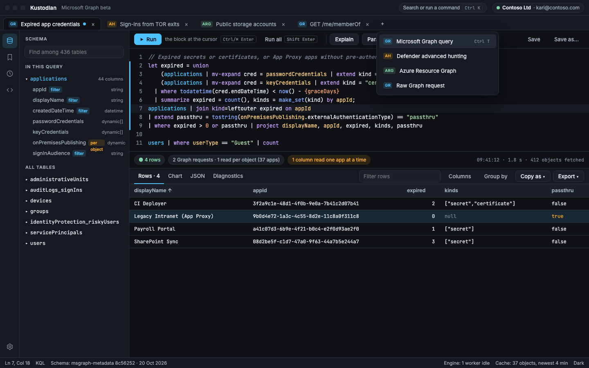
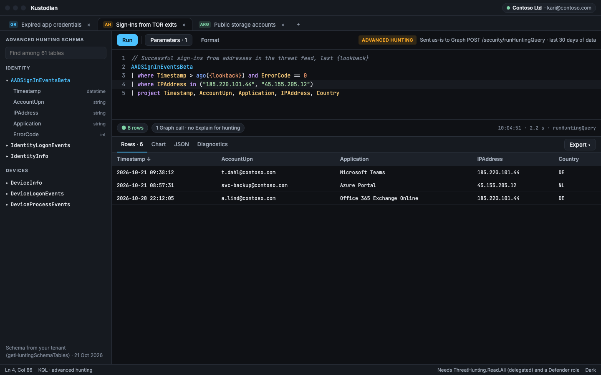
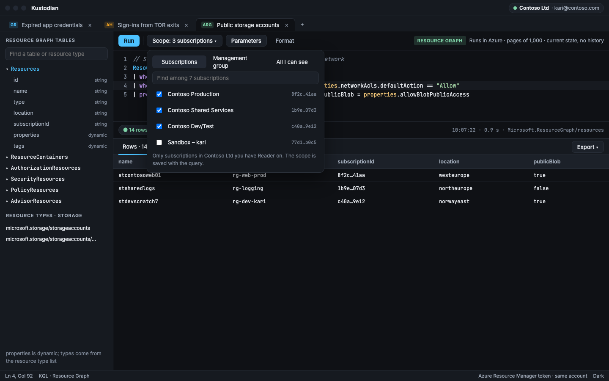
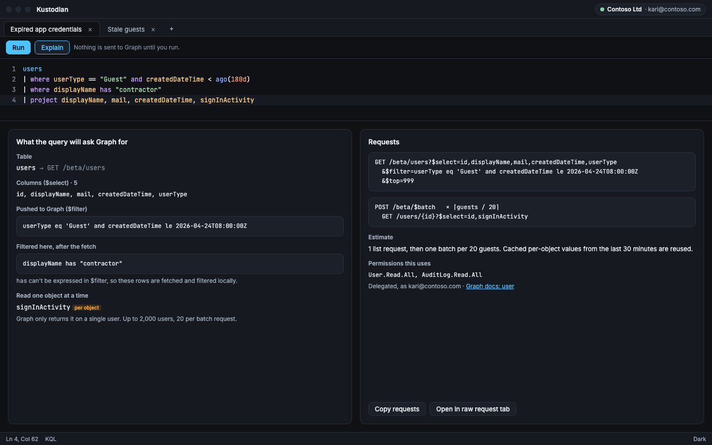
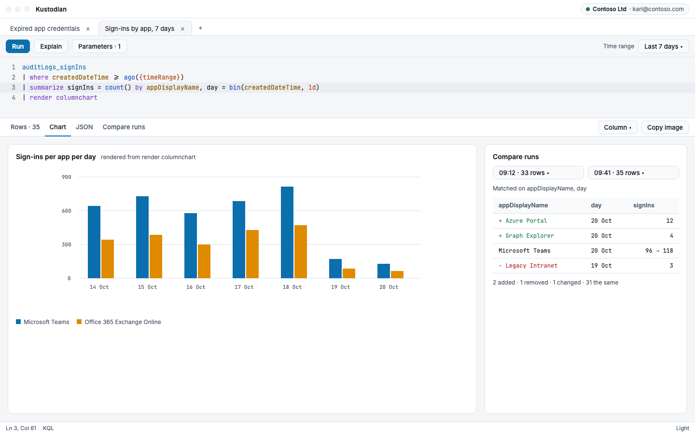

# Kustodian

[](https://github.com/FrodeHus/kustodian/actions/workflows/ci.yml)
[](LICENSE)

A desktop KQL workbench for your Microsoft tenant. Write one query language against **Microsoft Graph**, **Defender advanced
hunting** and **Azure Resource Graph**, with completion, parameters and results side by side. Runs on Windows, macOS and Linux.



## Why

Graph has no query language: answering "which apps have expired credentials?" means paging, `$filter` quirks and per-object
calls. Kustodian fetches Graph data and runs real KQL over it locally, and shows exactly which requests it will send before
it sends them. Hunting and Resource Graph queries go straight to their services, in the same editor.

## Features

- **Three sources, one editor**: Graph (beta), Defender hunting via `security/runHuntingQuery`, and Azure Resource Graph.
- **Schema-aware KQL**: completion and errors from each source's schema, including nested and `mv-expand`ed fields.
- **Explain**: see the Graph requests, `$filter` and permissions a query needs, without sending anything.
- **Results**: virtualized grid, charts, JSON and diagnostics; compare two runs; export to CSV, JSON or Markdown.
- **Workflow**: tabs that survive restarts, `{name}` parameters, snippets, saved queries, history and a command palette.
- **Raw Graph requests**, like Graph Explorer, with responses you can open as KQL tabs.
- Light and dark themes, and keyboard shortcuts for every action.

<table>
  <tr>
    <td><br><sub>Defender advanced hunting</sub></td>
    <td><br><sub>Azure Resource Graph, scoped to subscriptions</sub></td>
  </tr>
  <tr>
    <td><br><sub>Explain: the requests a query would send</sub></td>
    <td><br><sub>Charts and compare runs, light theme</sub></td>
  </tr>
</table>

<sub>Screenshots are rendered from the [design mockups](docs/design/mockups) and use sample data.</sub>

## Getting started

There are no prebuilt releases yet; [build from source](#building-from-source) and run:

```sh
dotnet run --project src/Kustodian
```

Sign in with your work account. By default Kustodian uses the Azure CLI's public client ID with delegated permissions. You
can use your own app registration instead (a public client with `http://localhost` as a mobile/desktop redirect URI), or let
Kustodian create one with **Create Entra ID application**.

## Privacy and security

Kustodian talks only to Microsoft's APIs. Tokens are cached in the OS keychain (DPAPI, Keychain or libsecret) and never
written in plain text. Settings, saved queries, snippets, history and open tabs are local JSON files in `%APPDATA%\Kustodian`,
`~/Library/Application Support/Kustodian` or `~/.config/kustodian`.

Report vulnerabilities as described in [SECURITY.md](SECURITY.md).

## Building from source

Requirements: [.NET SDK 10](https://dotnet.microsoft.com/download) (see [global.json](global.json)),
[Node.js 22](https://nodejs.org/), and on Linux WebKitGTK 4.1 and libsecret
(`sudo apt-get install libwebkit2gtk-4.1-dev libsecret-1-dev`).

```sh
dotnet build -warnaserror
dotnet test
```

The build runs `npm ci` and `npm run build` in `web/` when the UI is out of date, and embeds it. For the UI alone:
`cd web && npm ci && npm run lint && npm run typecheck && npm test`.

| Path | What |
| --- | --- |
| `src/Kustodian` | Desktop host: window, message channel, sign-in, storage |
| `src/Kustodian.Graph` | Graph schema, query planner, `$filter` translation, readers and cache |
| `src/Kustodian.Engine` | KQL engine worker (KustoLoco) |
| `src/Kustodian.Sources` | Defender hunting and Azure Resource Graph clients |
| `web/` | React UI (Vite, TypeScript, Vitest) |
| `docs/` | Design specs, plans, mockups and manual checks ([index](docs/README.md)) |

## Contributing

Contributions are welcome. Read [CONTRIBUTING.md](CONTRIBUTING.md) and the [Code of Conduct](CODE_OF_CONDUCT.md); changes are
recorded in the [CHANGELOG](CHANGELOG.md).

## License

[MIT](LICENSE)
